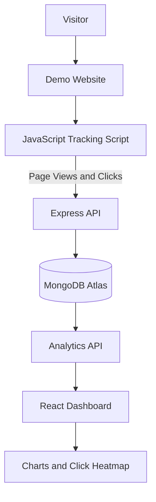

# User Analytics Dashboard

A full-stack web analytics platform that tracks visitor sessions, page views, and click interactions, then visualizes user activity through an interactive dashboard and click heatmap.

**Live Demo:** [Analytics Dashboard](https://user-analytics-dashboard-bice.vercel.app/) · [Tracked Demo Website](https://user-analytics-demo.onrender.com/) · [Backend API Health](https://user-analytics-dashboard-4xv1.onrender.com/api/health)

---

## Overview

User Analytics Dashboard helps website owners understand how visitors interact with their pages. A lightweight tracking script collects page views and click coordinates from a demo website, the backend stores events in MongoDB, and the dashboard visualizes the collected activity.

The application is deployed with Vercel, Render, and MongoDB Atlas.

## Features

- **Visitor Session Tracking** — Generates and maintains visitor session IDs.
- **Page View Analytics** — Records visits to tracked pages.
- **Click Tracking** — Captures click coordinates and viewport dimensions.
- **Interactive Dashboard** — Displays sessions, events, page views, and clicks.
- **Click Activity by Page** — Groups click events by page URL.
- **Event Distribution** — Visualizes page views versus clicks.
- **Click Heatmap** — Shows recorded click concentrations on tracked pages.
- **Demo Website** — Includes Home, Products, and About pages for generating sample analytics events.
- **Cloud Deployment** — Frontend, backend, and demo website are hosted separately.

## Live Applications

| Component | Technology | Link |
|---|---|---|
| Analytics Dashboard | React, Vite, Recharts | [Open Dashboard](https://user-analytics-dashboard-bice.vercel.app/) |
| Backend API | Node.js, Express, TypeScript | [API Health](https://user-analytics-dashboard-4xv1.onrender.com/api/health) |
| Demo Website | HTML, CSS, JavaScript | [Open Demo](https://user-analytics-demo.onrender.com/) |
| Database | MongoDB Atlas | Cloud-hosted database |

## Tech Stack

**Frontend**
- React
- TypeScript
- Vite
- Recharts
- CSS

**Backend**
- Node.js
- Express.js
- TypeScript
- Mongoose

**Database**
- MongoDB Atlas

**Tracking**
- JavaScript tracking script
- Browser Session Storage
- Fetch API

**Deployment**
- Vercel — dashboard frontend
- Render — backend API and demo website
- GitHub — source control and deployment integration


## Architecture




## How It Works

1. A visitor opens a page on the demo website.
2. The tracking script creates or retrieves a session ID.
3. Page views and click interactions are sent to the backend API.
4. The backend validates and stores analytics events in MongoDB.
5. The dashboard requests analytics data from the API.
6. Charts and the heatmap display the recorded activity.

Click coordinates are recorded relative to the browser viewport. Heatmap visualization represents the recorded click distribution and may not exactly reproduce the original webpage layout.

## Project Structure

```text
user-analytics-dashboard/
├── backend/
│   ├── src/
│   │   ├── models/
│   │   └── server.ts
│   ├── .env.example
│   ├── package.json
│   └── tsconfig.json
├── frontend/
│   ├── public/
│   ├── src/
│   │   ├── assets/
│   │   ├── App.tsx
│   │   ├── App.css
│   │   └── main.tsx
│   ├── package.json
│   └── vite.config.ts
├── demo-website/
│   ├── index.html
│   ├── product.html
│   ├── about.html
│   ├── style.css
│   └── tracker.js
├── .gitignore
└── README.md
```

## Run Locally

### Prerequisites

- Node.js and npm
- MongoDB Atlas account or a MongoDB instance
- Git

### 1. Clone the repository

```bash
git clone https://github.com/Ambreesh1/user-analytics-dashboard.git
cd user-analytics-dashboard
```

### 2. Configure the backend

```bash
cd backend
npm install
```

Create a `.env` file in the `backend` directory:

```env
PORT=4000
MONGODB_URI=your_mongodb_connection_string
```

Replace the placeholder with your own MongoDB connection string. Keep `.env` private and never commit database credentials.

Start the backend:

```bash
npm run dev
```

The backend should be available at `http://localhost:4000`.

### 3. Configure the frontend

Open a separate terminal:

```bash
cd frontend
npm install
```

Create a `.env.local` file inside `frontend`:

```env
VITE_API_URL=http://localhost:4000/api
```

Start the frontend:

```bash
npm run dev
```

Open the local URL printed by Vite, usually `http://localhost:5173`.

### 4. Run the demo website

Open another terminal at the project root and run:

```bash
npx http-server demo-website -p 5500
```

Open `http://localhost:5500` and interact with the demo pages to generate analytics events.

If the backend or frontend uses different local settings, update the corresponding environment variables before starting the application.

## Production Environment Variables

Configure these values in the respective hosting platforms:

| Variable | Used By | Purpose |
|---|---|---|
| `MONGODB_URI` | Backend | MongoDB connection string |
| `PORT` | Backend | Port supplied by the hosting platform or local environment |
| `VITE_API_URL` | Frontend | Base URL of the backend API |

For the deployed frontend, `VITE_API_URL` should point to:

```text
https://user-analytics-dashboard-4xv1.onrender.com/api
```

Do not expose database credentials or other secrets in frontend environment variables.

## Build and Validation

Build the backend:

```bash
cd backend
npm run build
```

Build the frontend:

```bash
cd frontend
npm run build
```

The production frontend build may display a bundle-size warning. This does not necessarily indicate a failed build.


## API Documentation

Base URL: `https://user-analytics-dashboard-4xv1.onrender.com`

All API endpoints below use the `/api` prefix.

| Method | Endpoint | Description |
|---|---|---|
| GET | `/api/health` | Checks API and database status |
| POST | `/api/events` | Validates and stores an analytics event |
| GET | `/api/sessions` | Returns sessions with event counts and timestamps |
| GET | `/api/sessions/:id/events` | Returns a session's events in chronological order |
| GET | `/api/events/clicks?pageUrl=...` | Returns click coordinates for a specific page |

### 1. Health Check

**Request**

```http
GET /api/health
```

**Example response**

```json
{
  "success": true,
  "message": "User Analytics API is running",
  "database": "connected"
}
```

### 2. Record an Event

**Request**

```http
POST /api/events
Content-Type: application/json
```

Example request body for a page view:

```json
{
  "sessionId": "example-session-123",
  "eventType": "page_view",
  "pageUrl": "/",
  "timestamp": "2026-10-13T10:00:00.000Z"
}
```

Example request body for a click:

```json
{
  "sessionId": "example-session-123",
  "eventType": "click",
  "pageUrl": "/product.html",
  "timestamp": "2026-10-13T10:01:00.000Z",
  "x": 240,
  "y": 180,
  "viewportWidth": 1366,
  "viewportHeight": 768
}
```

**Successful response — HTTP 201**

```json
{
  "success": true,
  "message": "Event stored successfully",
  "event": {
    "_id": "<generated-event-id>",
    "sessionId": "example-session-123",
    "eventType": "page_view",
    "pageUrl": "/",
    "timestamp": "2026-10-13T10:00:00.000Z"
  }
}
```

The `event` object includes the fields stored by Mongoose, including generated document metadata. The example above is abbreviated for readability.

Invalid payloads return HTTP 400 with an error message. A database or server failure returns HTTP 500.

### 3. List Sessions

**Request**

```http
GET /api/sessions
```

**Example response**

```json
{
  "success": true,
  "count": 1,
  "sessions": [
    {
      "sessionId": "example-session-123",
      "totalEvents": 5,
      "firstEventAt": "2026-10-13T10:00:00.000Z",
      "lastEventAt": "2026-10-13T10:05:00.000Z"
    }
  ]
}
```

### 4. Fetch a Session Timeline

**Request**

```http
GET /api/sessions/example-session-123/events
```

Returns the session's events in ascending timestamp order.

The response contains `success`, `sessionId`, `count`, and an `events` array. If no events exist for the requested session, the API returns HTTP 404.

### 5. Fetch Click Coordinates

**Request**

```http
GET /api/events/clicks?pageUrl=%2Fproduct.html
```

**Example response**

```json
{
  "success": true,
  "pageUrl": "/product.html",
  "count": 1,
  "clicks": [
    {
      "sessionId": "example-session-123",
      "pageUrl": "/product.html",
      "x": 240,
      "y": 180,
      "viewportWidth": 1366,
      "viewportHeight": 768
    }
  ]
}
```

The endpoint requires a non-empty `pageUrl` query parameter. Returned click records include available coordinate, viewport, session, and timestamp fields.

---


## MongoDB Data Model

The backend uses Mongoose to store analytics events. Each document represents a tracked interaction.

| Field | Type | Purpose |
|---|---|---|
| `sessionId` | String | Identifies the browser session |
| `eventType` | String | Identifies the event, such as `page_view` or `click` |
| `pageUrl` | String | Records the page where the event occurred |
| `timestamp` | Date | Records when the event occurred |
| `x` | Number | Horizontal click coordinate, when applicable |
| `y` | Number | Vertical click coordinate, when applicable |

Session analytics are derived by grouping events by `sessionId`. Click analytics filter click events and use their recorded coordinates.

The exact validation rules, optional fields, timestamps, and database indexes are defined by the Mongoose model.


### Indexes

The schema defines two compound indexes:

- `{ sessionId: 1, timestamp: 1 }` — supports queries that retrieve events for a session in chronological order.
- `{ eventType: 1, pageUrl: 1 }` — supports filtering events by type and page, including click analytics.

### Data Flow

1. The tracking script generates a session ID and captures page-view or click events.
2. The frontend tracking script sends the event to `POST /api/events`.
3. The Express backend validates the payload and stores it using Mongoose.
4. The dashboard retrieves session summaries and click coordinates through the analytics endpoints.
5. React components visualize the resulting metrics and heatmap.

---

## Demo Video

A short walkthrough demonstrates the deployed application, event collection, analytics dashboard, and click heatmap.

**Video:** https://drive.google.com/file/d/15HflK2kbEeD16nlWPs1K38xXHa6UcuUf/view?usp=drivesdk


  ## Assumptions

The following assumptions guided the implementation of the User Analytics Dashboard:

- **Session identification:** A browser session is identified using a session ID stored in `sessionStorage`. This helps associate events within the same browser tab session without requiring user registration.
- **Event scope:** Page views and click events are sufficient to demonstrate the core analytics workflow for this project.
- **Demo traffic:** The included demo website acts as a controlled environment for generating events and validating dashboard functionality.
- **Click coordinates:** Click positions are collected along with viewport dimensions and scroll offsets to support heatmap visualization. These coordinates represent recorded interactions, not an exact reconstruction of the original page.
- **Near-real-time updates:** Analytics data is retrieved from the backend when the dashboard loads or the user refreshes the data. Continuous real-time streaming is not assumed.
- **Privacy and identity:** The system focuses on anonymous interaction events rather than collecting personally identifiable information or tracking authenticated user identities.

## Trade-offs and Design Decisions

| Decision | Trade-off |
|---|---|
| `sessionStorage` for session IDs | Simple browser-based session tracking, but the ID is not shared across separate tabs and does not provide persistent user identity. |
| Client-side event tracking | Easy to integrate into a website, but events may be missed if JavaScript fails, the network is unavailable, or the request is blocked. |
| Express API with MongoDB Atlas | Provides a straightforward way to ingest and store analytics events, but a production-scale system may require additional indexing, aggregation, and retention strategies. |
| React, Vite, and Recharts | Enables a lightweight dashboard with interactive charts, but advanced analytics and complex visualizations require additional implementation. |
| Viewport-based click heatmap | Simple to implement and useful for demonstrating interaction patterns, but it does not guarantee pixel-perfect alignment across different screen sizes, scroll positions, or page layouts. |
| Separate frontend, backend, and demo deployments | Allows each component to be deployed independently, but introduces configuration, CORS, and service-availability dependencies. |
| Manual refresh for updated analytics | Keeps the initial implementation simple and avoids continuous polling, but the dashboard does not automatically display every newly recorded event. |

## Limitations and Future Improvements

- Add configurable date ranges and more advanced analytics filters.
- Introduce automatic refresh or WebSocket-based updates.
- Improve heatmap accuracy by normalizing coordinates and accounting for page layout, viewport size, and scroll position.
- Add event batching, retry handling, and stronger ingestion validation.
- Introduce authentication, rate limiting, and appropriate data-retention controls before production use.
- Evaluate database indexing and aggregation strategies as event volume grows.

## Author

**Ambreesh**

- GitHub: [@Ambreesh1](https://github.com/Ambreesh1)

---

If you find this project useful, consider giving the repository a star!
